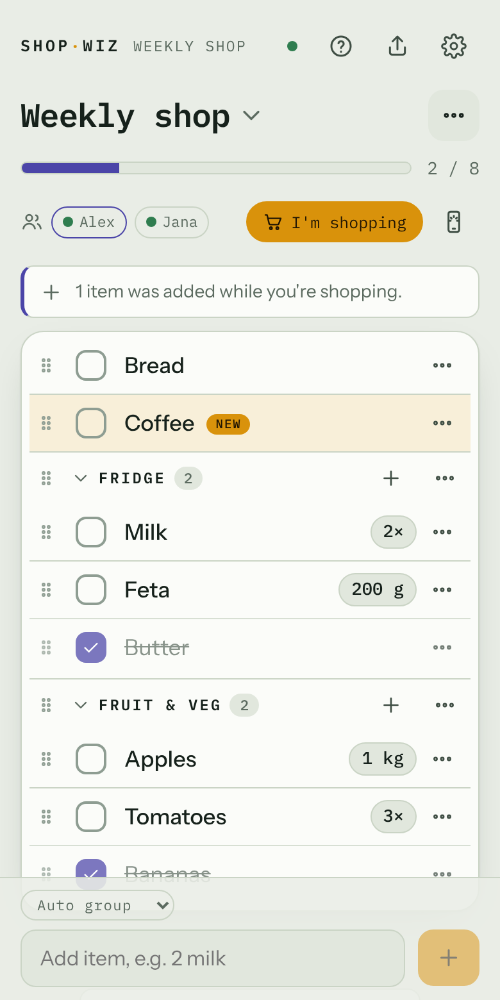
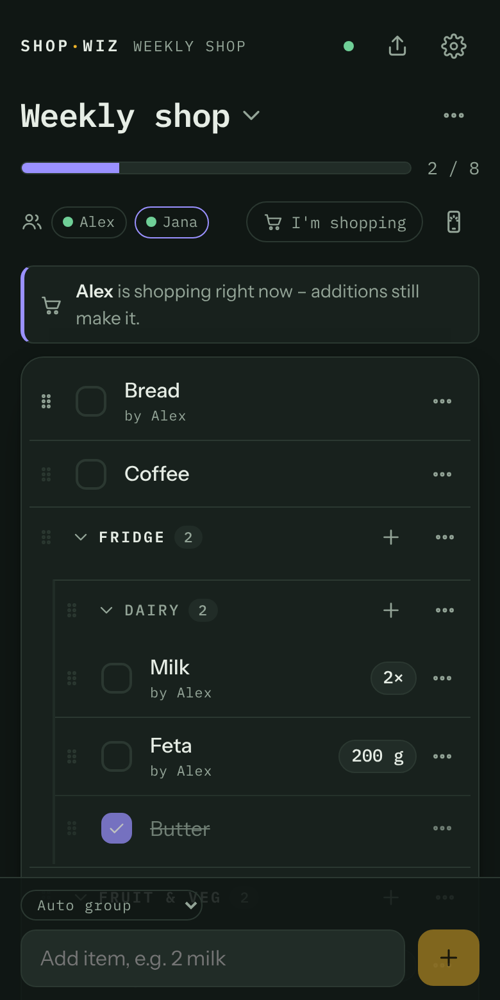
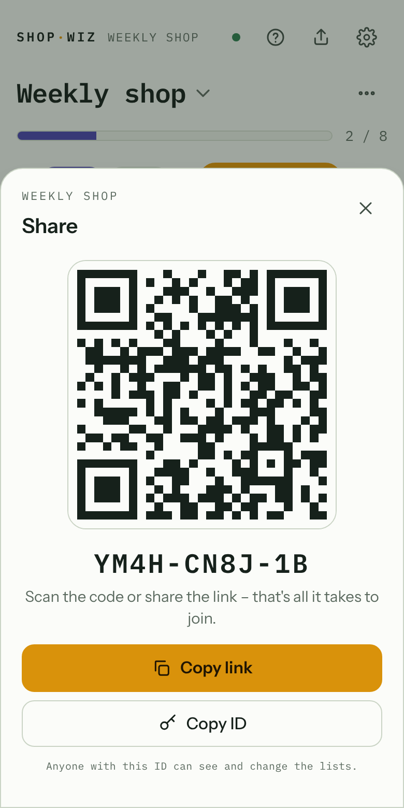

# ShopWiz

**Geteilte Einkaufslisten ohne Anmeldung und ohne Tracking.**
Liste erzeugen, die 10-stellige ID (oder einen QR-Code) teilen – und alle kaufen mit. In Echtzeit, auf jedem Gerät, auch bei schlechtem Empfang im Supermarkt.

🇬🇧 [English version](README.md) (maßgeblich)

<p>
  
  
  
</p>

---

## Inhalt

- [Funktionen](#funktionen)
- [So funktioniert es](#so-funktioniert-es)
- [Installation mit Docker / Portainer](#installation-mit-docker--portainer)
- [HTTPS und Reverse Proxy](#https-und-reverse-proxy)
- [Einstellungen](#einstellungen)
- [Ohne Docker starten](#ohne-docker-starten)
- [Backup und Update](#backup-und-update)
- [Administration (optional)](#administration-optional)
- [Datenschutz](#datenschutz)
- [Entwicklung](#entwicklung)
- [Sprache hinzufügen](#sprache-hinzufügen)

## Funktionen

| | |
|---|---|
| **Kein Login** | Eine 10-stellige ID ist der Schlüssel zu deinen Listen. Sie wird auf dem Gerät gespeichert und lässt sich mit einem Tipp wieder entfernen. |
| **Mehrere Listen pro ID** | Per Dropdown zwischen Listen wechseln (z. B. „Wocheneinkauf“, „Baumarkt“). |
| **Gruppen, die mitlernen** | Die Liste nach Gruppen sortieren (z. B. *Bäcker*, *Kühlwaren*). Milch einmal in „Kühlwaren“ – ab dann landet sie automatisch dort, bis du sie woandershin schiebst. |
| **Live-Synchronisation** | Änderungen erscheinen innerhalb einer Sekunde auf allen Geräten. |
| **Offline nutzbar** | Änderungen werden auf dem Gerät gespeichert und später gesendet. Wurde dasselbe Feld gleichzeitig geändert, erscheint eine softe Meldung, in der man den richtigen Wert wählt. |
| **Autovervollständigung** | Alles, was je hinzugefügt wurde, wird beim Tippen vorgeschlagen – inklusive gelernter Gruppe. |
| **Mengen-Knöpfe** | Auf Tablet und Computer stehen − und + direkt neben der Menge (g/ml in 100er-Schritten). Auf dem Handy ändert man die Menge im Bearbeiten-Dialog des Artikels. |
| **Schlaue Eingabe** | `2 Milch`, `500g Hack`, `Milch x2` werden in Menge und Name zerlegt. Mehrere eingefügte Zeilen ergeben mehrere Artikel. |
| **Hinweis bei Doppelten** | „Milch steht schon drauf“ → Menge erhöhen oder trotzdem hinzufügen. Abgehakte Artikel werden einfach wieder aktiviert. |
| **Neuer Artikel mit Details** | Lange auf das gelbe + drücken öffnet einen Dialog: Name, Menge, Priorität, Notiz, Gruppe und Liste auf einmal; „Weiterer“ lässt ihn offen. Mit der installierten App: App-Symbol lange drücken → „Artikel hinzufügen“ (unter Android muss die App dafür aus Chrome oder Edge installiert sein – Brave und andere können das Kürzel nicht anlegen). |
| **An ShopWiz teilen** | Text auf einer Webseite oder in einer Notiz markieren → Teilen → ShopWiz: Jede Zeile wird ein Artikel (App unter Android aus Chrome oder Edge installiert – andere Browser melden sie nicht als Teilen-Ziel an). |
| **Schriftgröße** | Klein, normal oder groß pro Gerät; der Fokus-Modus hat eine eigene Größe („Aa“). |
| **Wichtig / unwichtig** | Artikel als ↑ wichtig („nicht ohne nach Hause kommen“) oder ↓ unwichtig markieren. Wichtige Artikel stehen oben in ihrer Gruppe, unwichtige unten. Einstellbar in den Artikeldetails oder mit dem Knopf neben der Gruppenauswahl; pro Liste optional mit den Kürzeln `!Windeln` / `? Basilikum` beim Eintippen. Wie die Markierung aussieht, wählt jedes Gerät selbst. |
| **Abgehaktes bleibt** | Wandert ans Ende der Gruppe und kann wieder aktiviert werden. Das Auge blendet es beim Einkaufen aus (pro Gerät). |
| **Wischen** | Auf dem Handy einen Artikel in die eine Richtung wischen hakt ab, in die andere schiebt ihn zu „Inaktiv“ (mit Rückgängig). Welche Richtung was macht – oder ob Wischen aus ist – stellt jedes Gerät selbst ein. |
| **Einkauf abschließen** | Ist alles abgehakt: Ein Knopf schiebt das Abgehakte zu „Inaktiv“, beendet den Check-in und lässt den Bildschirm wieder ausgehen. |
| **Fokus-Modus** | Nur noch die Liste: Kategorien und Artikel zum Abhaken, groß, je nach Skin schwarz auf weiß oder weiß auf schwarz. Wischen und „Bildschirm anlassen“ gehen dort auch. Ein Banner oben beendet ihn. |
| **Suche** | Die Lupe neben dem Listennamen filtert die Liste – auch Notizen, Übersetzungen und inaktive Artikel. |
| **Als Text teilen** | Die offenen Artikel untereinander in einen Chat oder eine Notiz schicken (Teilen-Menü des Geräts oder Zwischenablage). |
| **Inaktive Artikel** | Eine eingeklappte „Schattenliste“ am Ende jeder Liste, mit denselben Gruppen wie die Liste: Dinge, die gerade nicht gebraucht werden, und Gruppen ohne Artikel. „Abgehakte Artikel zu ‚Inaktiv‘ verschieben“ schiebt Abgehaktes dorthin; ein Tipp holt es zurück auf die Liste. |
| **Adresse des Ladens** | Optional bekommt eine Liste die Adresse ihres Ladens – neben dem Listennamen erscheint dann „Navigation starten“ (auf dem Handy nur als Pfeil). |
| **Backup & Import** | Listen (mit Reisemodus und Übersetzungen) als Markdown-Datei herunterladen, in jedem Texteditor bearbeiten und wieder importieren – in dieselbe ID (ohne Duplikate) oder als neue ID. |
| **Teilnehmer** | Jedes Gerät gibt sich einen Namen. Die Details eines Artikels zeigen, wer ihn hinzugefügt oder abgehakt hat. Geräte können entfernt werden. |
| **„Ich bin im Laden“** | Die anderen sehen, dass du gerade einkaufst. Was währenddessen dazukommt, wird bei dir hervorgehoben. |
| **Reisemodus** | Einkaufen im Ausland? Pro Liste steht unter jedem Artikel die Übersetzung – mit der Flagge des Landes, das aus der Ladenadresse kommt. Antippen zeigt sie groß fürs Personal. Alles auf einmal übersetzen oder einzelne Artikel korrigieren. |
| **Listenverbund** | Mehrere Läden mit ähnlichem Sortiment (z. B. Lidl und zwei Conad) teilen sich ihre Artikel: 400 g Hack stehen in allen, abgehakt wird einmal – egal wo – mit grünem Etikett „bei Lidl gekauft“. Gruppen und Reihenfolge bleiben pro Laden. Der Baumarkt sieht davon nichts. |
| **KI-Assistenten** | Claude, ChatGPT, Grok oder Siri lesen deine Listen und – wenn pro ID erlaubt – fügen Artikel hinzu oder haken ab. Jeder ist ein eigener Teilnehmer mit eigenem Schlüssel. |
| **Sich im Laden finden** | In großen Läden sieht jeder Eingecheckte, wo die anderen sind (die Gruppe ihres zuletzt abgehakten Artikels). Ein **Rufen**-Knopf schickt eines von vier festen Signalen – „Wo bist du?“, „Komm zu mir“, „Treffen an der Kasse“, „Ich bin fertig“ – kein Chat. |
| **Bildschirm anlassen** | Optionaler Knopf, damit das Handy beim Einkaufen nicht sperrt. |
| **Verlauf** | Wer hat was gemacht, mit „Wiederherstellen“ für gelöschte Artikel. Wird nach 14 Tagen automatisch geleert. |
| **Rückgängig** | Jede Aktion lässt sich sofort rückgängig machen. |
| **Teilen** | QR-Code und natives Teilen-Menü mit ordentlichem Titel. Ein Kamera-Knopf scannt QR-Codes. Link-Vorschauen in Messengern bleiben neutral: nie der Name der ID oder was drauf ist. |
| **Kopieren / Verschieben** | Artikel und ganze Gruppen in eine andere Liste oder eine andere ID übertragen, in der du auch bist. |
| **ID erneuern** | Neue ID, die alte funktioniert nicht mehr. Alle teilnehmenden Geräte ziehen automatisch mit um. |
| **ID löschen** | Für alle, mit doppelter Bestätigung. Teilnehmer können mit einer Kopie unter neuer ID weitermachen. |
| **Sprachen** | Englisch und Deutsch, pro Gerät wählbar. Deine Einträge werden nur übersetzt, wenn du für eine Liste den Reisemodus einschaltest. |
| **Skins** | Dunkel, AMOLED (echtes Schwarz), Abendrot (dunkles Pflaumenrot und Koralle), Hell, Minze (zartes Mint und Grün) und Mango (kräftig und fruchtig) – pro Gerät in den Einstellungen wählbar. Weitere lassen sich als CSS-Datei ablegen, auch auf einem laufenden Server. Beim ersten Besuch folgt ShopWiz dem Browser (Dunkel oder Hell). Alle Skins halten den Kontrast-Standard WCAG AA ein (automatisch getestet). Design: *Feierabend-Designsystem v4*. |
| **Eingebaute Hilfe** | Ein (?) in der Kopfzeile (und „So funktioniert ShopWiz“ auf der Startseite) erklärt alle Funktionen in kurzen Themen – offline und in der Sprache des Geräts. Neue Nutzer bekommen einmalig einen Hinweis. |
| **Installierbar** | Läuft als App auf dem Homescreen (PWA). Unter Android aus Chrome oder Edge installieren: Nur die geben der App ihr Kürzel („Artikel hinzufügen“) und das Teilen-Ziel – Brave, Firefox und andere legen nur ein Lesezeichen auf den Homescreen. |

## So funktioniert es

### Die ID

- Eine ID sieht so aus: `K7QM-2XPA-9F` – 10 Zeichen, ohne leicht verwechselbare Zeichen (kein `O`/`0`, `I`/`1`, `L`).
- **Wer die ID kennt, kann die Listen öffnen und ändern.** Behandle sie wie einen Schlüssel.
- Der Link `https://dein-server/K7QM2XPA9F` öffnet die Listen direkt.
- Jede ID hat einen Namen (muss nicht einmalig sein) und kann bis zu 10 Listen enthalten. Der inaktive Teil einer Liste behält seine 250 jüngsten Artikel; ältere werden gelöscht und bleiben 14 Tage im Verlauf.
- **Ablauf:** Eine ID wird samt allen Daten gelöscht, wenn sie **181 Tage lang kein aktives Gerät** hatte. Pro ID in den Einstellungen änderbar (7–367 Tage).

### Geräte und Teilnehmer

- Beim ersten Öffnen gibst du deinem Gerät einen Namen („Jakes Handy“).
- Die Teilnehmerzeile zeigt alle; ein grüner Punkt heißt „gerade online“.
- Jeder Teilnehmer kann Geräte entfernen. Ohne Login ist das keine Sperre – mit der ID kann man wieder beitreten. Wer jemanden wirklich aussperren will, nutzt **Einstellungen → ID erneuern**.
- Geräte ohne Aktivität seit **30 Tagen** werden automatisch entfernt und können jederzeit mit Link oder ID wieder teilnehmen.
- Ein Gerät ist in höchstens 10 IDs gleichzeitig; **Einstellungen → ID auf diesem Gerät vergessen** macht einen Platz frei. Eine ID hat Platz für 100 Geräte.

### Gruppen und Mitlernen

- Jede Liste hat standardmäßig eigene Gruppen. Unter **Listen-Optionen → Gruppen** kann eine Liste stattdessen die **gemeinsamen Gruppen der ID** nutzen – dann teilen sich alle Listen in diesem Modus Gruppen und Gelerntes.
- Mit **+** an einer Gruppe fügst du direkt dort hinzu, oder du ziehst Artikel am Griff (⋮⋮) in eine andere Gruppe.
- ShopWiz merkt sich zu jedem Artikelnamen die letzte Gruppe. Beim nächsten Hinzufügen landet er automatisch dort.

### Inaktive Artikel (Schattenliste)

Am Ende jeder Liste gibt es den eingeklappten Bereich **Inaktive Artikel**:

- **Abgehakte Artikel zu „Inaktiv“ verschieben** schiebt Abgehaktes dorthin – nichts geht verloren. Gruppe, Menge und Notiz bleiben erhalten.
- Ein Tipp auf einen inaktiven Artikel (oder sein **+**) holt ihn unabgehakt zurück auf die Liste.
- Dinge, die noch nicht gebraucht werden, direkt dort hinzufügen – oder Artikel am Griff hinein- und herausziehen.
- Wer den Namen eines inaktiven Artikels normal eintippt, holt ihn zurück, statt ein Duplikat anzulegen.
- Die Liste selbst zeigt nur Gruppen, in denen Artikel stehen. Wird der letzte Artikel einer Gruppe inaktiv, wandert die Gruppe mit nach unten (weiter unter ihrem Namen) und kommt zurück, sobald einer ihrer Artikel wieder auf der Liste steht. Leere Gruppen warten dort ebenfalls – einen Artikel schiebt man über seine Details hinein. Eine neu angelegte Gruppe ist leer, deshalb zielt die Eingabezeile direkt auf sie: Der nächste getippte Artikel landet dort.
- Inaktive Artikel zählen nicht zum Fortschritt. **Alle inaktiven löschen** löscht sie wirklich (14 Tage über den Verlauf wiederherstellbar).

### Adresse und Navigation

In den **Listen-Optionen** kann die Adresse des Ladens eingetragen werden (oder ein Karten-Link). Neben dem Listennamen erscheint dann **Navigation starten** – auf Tablet und Computer ausgeschrieben, auf dem Handy als Pfeil. Er öffnet die Karten-App des Geräts: Android bietet die installierten Navi-Apps an, iPhone/Mac nutzen Apple Karten, andere Geräte Google Maps im Browser. Erst beim Antippen wird ein Kartendienst geöffnet.

### Backup und Import als Datei

**Einstellungen → Backup & Import** (auch in den Listen-Optionen):

- **Exportieren** lädt eine Markdown-Datei (`.md`) herunter – alle Listen der ID oder nur die aktuelle Liste. Funktioniert auch offline.
- **Importieren** nimmt so eine Datei, beliebiges Markdown oder einfachen Text mit einem Artikel pro Zeile – Datei auswählen oder Text einfügen.
  - **In diese ID:** Listen und Gruppen werden über den Namen zugeordnet; ein Artikel, der schon auf der Liste steht, wird nicht doppelt angelegt (sagt die Datei, dass er gebraucht wird, und er ist abgehakt oder inaktiv, wird er wieder aktiviert). Artikel ohne Listen-Überschrift landen in der aktuellen Liste.
  - **Als neue ID:** legt eine neue ID mit den importierten Listen an. Das geht auch direkt auf der Startseite („Datei als neue Liste importieren“).

Das Format lässt sich leicht von Hand schreiben:

```markdown
# Zuhause                        ← Name der ID (optional)
## Wocheneinkauf                 ← Liste
> 📍 Via Roma 1, Olbia           ← Adresse des Ladens (optional)
- [ ] Brot                       ← offener Artikel ohne Gruppe
### Kühlwaren                    ← Gruppe
- [ ] 2 l Milch // laktosefrei   ← Menge, Name, Notiz nach //
- [x] Butter                     ← abgehakt
- [-] Feta                       ← inaktiv
- [ ] ! Windeln                  ← „!“ wichtig, „?“ unwichtig
```

Eine Liste im Reisemodus behält Land und Sprache, ihre Artikel die Übersetzungen:

```markdown
## Olbia
> ✈️ IT it                       ← Reisemodus: Land, Sprache
- [ ] 1 l Milch → Latte          ← Übersetzung nach →
```

Beim Import bleiben Übersetzungen, die die ID schon hat, erhalten.

Eine Liste im Listenverbund nennt die verbundenen Listen; ihre gemeinsamen Artikel stehen einmal, unter ihrer Ursprungsliste:

```markdown
## Lidl
> 🔗 Conad 1, Conad 2            ← Listenverbund
- [ ] 400 g Hackfleisch          ← gemeinsam
- [ ] ↯ Grillkohle               ← „↯“ nur in dieser Liste
```

Einfache Zeilen wie `Milch`, `- 2 Brot` oder `* Äpfel` funktionieren auch. Ein Name, der mit einer Zahl beginnt und keine Menge hat, steht in Anführungszeichen (`"4711 Kölnisch Wasser"`).

### Listenverbund

Für mehrere Lebensmittelläden in einer ID: Ein Artikel soll in *einem* davon gekauft werden – egal in welchem.

- **Verbinden:** Listenmenü → „Listenverbund“ → die anderen Listen anhaken. Die Verbindung gilt für alle Beteiligten (hakt man in Lidl Conad 1 und Conad 2 an, sind alle drei verbunden), eine Liste gehört zu höchstens einem Verbund. Ein grünes Ketten-Symbol am Listennamen zeigt ihn.
- **Bestehende Artikel:** Beim Verbinden fragt ShopWiz einmal „Bestehende Artikel im Verbund teilen?“. Ja: gleiche Artikel werden zu einem zusammengeführt (größere Menge, Notizen zusammen, offen schlägt abgehakt, wichtig schlägt normal) – mit Rückgängig. Nein: Nur neue Artikel werden geteilt.
- **Hinzufügen:** Neben dem Prioritäts-Knopf zeigt ein grüner Knopf „Verbund“, dass der nächste Artikel in alle verbundenen Listen kommt. Antippen: „Nur Conad“. Die Grundeinstellung ist pro Gerät wählbar (Einstellungen → „Neue Artikel im Listenverbund“).
- **Im Laden:** Ein gemeinsamer Artikel hat einen Status. In Lidl abgehakt → in Conad ebenfalls abgehakt, mit grünem Etikett „bei Lidl gekauft“. Nach „Inaktiv“ kommt er wie gewohnt über „Einkauf abschließen“ – dann für alle. Gruppen und Reihenfolge lernt jeder Laden für sich; kennt ein Laden den Artikel noch nicht, steht er dort ohne Gruppe.
- **Artikeldetails:** ein Schalter „Auch bei CONAD Cagliari“ (bei mehreren Partnern „Im ganzen Verbund“) – aus = nur in dieser Liste.
- **Lösen:** Verlässt eine Liste den Verbund, behält sie eine eigene Kopie aller gemeinsamen Artikel, die anderen behalten die gemeinsamen. Bleibt nur eine Liste übrig, endet der Verbund.
- Verbinden und Lösen geht nur online. KI-Assistenten sehen den Verbund (`listGroup`) und fügen in den ganzen Verbund hinzu, mit `onlyThisList` nur in eine Liste.

### Sich im Laden wiederfinden

Läden können groß sein, und wer sich aufteilt, verliert sich. Solange man eingecheckt ist (**Ich bin im Laden**):

- Im Banner der anderen im Laden steht, **wo sie gerade sind**: die Gruppe des zuletzt abgehakten Artikels („Jana kauft gerade ein – bei Obst & Gemüse · gerade eben“). Kein GPS – die Gruppen der Liste sind die Karte.
- Sobald mindestens eine weitere Person im Laden ist, erscheint neben „Ich bin im Laden“ der Knopf **Rufen** (auf dem Handy nur als Pfeil). Er schickt ein festes Signal an alle im Laden oder an eine Person:
  - **Wo bist du?** – das andere Handy vibriert und zeigt eine Karte; ein Tipp antwortet „Bin bei *Bäcker*“ (der eigene letzte Ort), „Komm zur Kasse“ oder eine gewählte Gruppe.
  - **Komm zu mir – *Kühlwaren*** – mit dem eigenen letzten Ort (oder einer gewählten Gruppe).
  - **Treffen an der Kasse** · **Ich bin fertig**
- Wird der letzte Artikel abgehakt, bekommen alle anderen im Laden „Alles im Wagen – Treffen an der Kasse?“.

Freitext gibt es bewusst nicht, damit es nie ein Chat wird. Signale landen nie in der Datenbank. Ist ein Handy gerade offline oder das Display aus, hält der Server das Signal bis zu 30 Minuten im Arbeitsspeicher und liefert es nach, sobald ShopWiz dort wieder offen ist. Wer ohne Empfang ruft, dessen Signal geht raus, sobald die Verbindung wieder da ist.

Ist alles abgehakt, erscheint **Einkauf abschließen** (auch als Hinweis direkt nach dem letzten Haken): Abgehaktes wandert zu „Inaktiv“, der Check-in endet und „Bildschirm anlassen“ wird ausgeschaltet. Sonst endet der Check-in per Knopf oder automatisch nach **60 Minuten ohne Aktivität** (Abhaken, Hinzufügen, Rufen oder ShopWiz öffnen verlängern ihn).

### Reisemodus

Für Läden, in denen das Personal deine Sprache nicht spricht. Im Listenmenü (⋯ neben dem Listennamen) **Artikel in Landessprache zeigen** einschalten:

- Das **Land** kommt aus der Ladenadresse der Liste (z. B. `Via Roma 3, Olbia, Italia` → 🇮🇹 Italienisch) – erkannt auf dem Gerät, ohne Kartendienst. Steht kein Land in der Adresse oder hat das Land mehrere Sprachen (Schweiz, Belgien …), wählst du es aus.
- Unter jedem Artikel steht kursiv die Übersetzung mit Landesflagge. **Antippen** zeigt sie bildschirmfüllend fürs Personal; wischen (oder die Pfeile) geht zum nächsten Artikel.
- **N Artikel übersetzen** übersetzt alles Fehlende auf einmal. Einzelne Artikel werden in den Artikeldetails übersetzt oder korrigiert – das Hinzufügen bleibt wie bisher.
- Übersetzungen werden pro Name für die ganze ID gemerkt: Ist „Milch“ einmal „Latte“, gilt das auf jeder Liste und jedem Gerät, ohne den Übersetzungsdienst erneut zu fragen. Eine selbst eingetippte Übersetzung überschreibt keine Maschine.
- Reisemodus aus blendet die Übersetzungen nur aus.

Die maschinelle Übersetzung läuft über den ShopWiz-Server – ein Übersetzungsdienst sieht nur Artikelnamen, nie dein Gerät oder deine Adresse. `TRANSLATE_PROVIDER` nennt einen Dienst oder mehrere in Reihenfolge, z. B. `deepl,azure`: Ist einer aufgebraucht, nicht erreichbar oder lehnt den Schlüssel ab, springt der nächste ein. Jeder Dienst hat eigene Einstellungen (siehe [Einstellungen](#einstellungen)):

| Dienst | Kostenlos | Braucht |
|---|---|---|
| `mymemory` (Standard) | ca. 5.000 Zeichen pro Tag, ca. 50.000 mit `MYMEMORY_EMAIL`; bei Einzelwörtern wechselhaft | nichts |
| `deepl` | DeepL API (Developer-Tarif): einmalig 1.000.000 Zeichen – erneuern sich nicht | `DEEPL_API_KEY` |
| `azure` | Microsoft Translator, Gratisstufe „F0“: ca. 2.000.000 Zeichen pro Monat | `AZURE_TRANSLATOR_KEY`, meist `AZURE_TRANSLATOR_REGION` |
| `google` | Google Cloud Translation: ca. 500.000 Zeichen pro Monat über das Monatsguthaben | `GOOGLE_API_KEY` |
| `libretranslate` | unbegrenzt, selbst gehostet (Open Source, 1–2 GB RAM) – bei zusammengesetzten Wörtern deutlich schwächer | `LIBRETRANSLATE_URL`, siehe Beispiel in der `docker-compose.yml` |
| `none` | – | Übersetzungen nur von Hand |

Eine gute kostenlose Kombination: `TRANSLATE_PROVIDER=deepl,azure,mymemory` – zuerst DeepLs Qualität, Microsoft als dauerhafte Reserve, MyMemory als letzter Ausweg.

**Jede ID kann ihren eigenen Dienst mitbringen.** Einstellungen → Übersetzung bietet *Server-Übersetzung* (die Dienste oben, falls konfiguriert), *DeepL / Google / Microsoft – eigener API-Schlüssel*, *MyMemory – kostenlos* oder *Aus*. Der Schlüssel einer ID liegt verschlüsselt auf dem Server (`ENCRYPTION_KEY`), wird nie wieder angezeigt (nur seine letzten vier Zeichen) und nur von dieser ID genutzt; das Tageslimit des Servers (`TRANSLATE_DAILY_CHARS`) gilt dafür nicht. Alle in der ID können die Einstellung ändern. LibreTranslate gibt es nur als Server-Dienst – es ist eine Adresse, die der Server aufrufen würde. Soll niemand Fremdes dein Kontingent verbrauchen können? Dann kommt kein bezahlter Schlüssel in die Server-Einstellungen: `TRANSLATE_PROVIDER` bleibt bei `mymemory` oder `none`, und jede ID zahlt mit ihrem eigenen Schlüssel.

Artikelnamen sind kurz (10–15 Zeichen), und jeder Name wird pro ID nur einmal übersetzt – gemerkte Übersetzungen kosten nichts. Selbst DeepLs einmalige Million reicht für zehntausende Artikel. „Übersetzen“ in den Artikeldetails fragt immer neu an; im Listenmenü lassen sich alle Übersetzungen der Liste löschen, um neu anzufangen. Die Artikeldetails zeigen, welcher Dienst übersetzt hat, und Einstellungen → Übersetzung nennt die Dienste, jeweils mit grünem oder rotem Punkt – der Server prüft jeden Dienst (Schlüssel fehlt oder falsch, aufgebraucht, nicht erreichbar) und nennt den Grund. Bei DeepL steht dort auch, wie viel vom Kontingent verbraucht ist („271 von 1.000.000 Zeichen genutzt“), ausgewiesen als Server-Kontingent oder eigenes Kontingent der ID.

### KI-Assistenten (Claude, ChatGPT, Grok, Siri)

Assistenten können die Listen lesen und – wenn du es erlaubst – ändern: „Plan Abendessen für die Woche und schreib die Zutaten auf die Liste“, „Was steht noch auf der Baumarkt-Liste?“, „Hey Siri, Milch auf die Liste“.

1. Für den Server einschalten: `MCP_ENABLED: "true"` (siehe [Einstellungen](#einstellungen)). ShopWiz muss per **HTTPS** aus dem Internet erreichbar sein – die Server der Assistenten rufen es auf.
2. In ShopWiz: **Einstellungen → KI-Assistenten**.
   - **Assistenten dürfen Listen ändern** – standardmäßig aus: Assistenten können nur lesen. An: Sie können Artikel hinzufügen, abhaken, ändern (Menge, Notiz, Priorität, Gruppe, Übersetzung) und zu „Inaktiv“ schieben – löschen können sie keinen Artikel. Außerdem: Gruppen anlegen, sortieren, umbenennen und löschen (die Artikel bleiben dabei auf der Liste) und den Reisemodus einstellen. Gilt für alle Assistenten dieser ID.
   - **Assistent verbinden**: Claude, ChatGPT, Grok, Siri oder ein eigener Name. Jeder Assistent bekommt einen eigenen geheimen Schlüssel und erscheint als eigener Teilnehmer (mit „KI“ markiert) – auch im Verlauf („Claude hat 8 Artikel hinzugefügt“). Der Schlüssel wird nur einmal angezeigt; Assistent entfernen (hier oder bei den Teilnehmern) trennt ihn.
3. Im Assistenten eintragen:

| Assistent | So geht's |
|---|---|
| **Claude** (Web, Desktop, App) | Einstellungen → Konnektoren → *Benutzerdefinierten Konnektor hinzufügen* → Name „ShopWiz“, MCP-Adresse `https://<dein-server>/mcp/swk_…` einfügen |
| **ChatGPT** | Einstellungen → Apps & Konnektoren → Entwicklermodus einschalten → *Konnektor erstellen* → MCP-Adresse einfügen, ohne Authentifizierung. Hängt vom Tarif ab. |
| **Grok** | grok.com/connectors → *Neuer Konnektor* → *Benutzerdefiniert* → MCP-Adresse einfügen |
| **Siri** | App „Kurzbefehle“: *Text diktieren* → *Inhalte von URL abrufen*: `https://<dein-server>/api/v1/lists/default/items`, Methode POST, Header `Authorization: Bearer swk_…`, JSON-Feld `text` = diktierter Text. ShopWiz zeigt diese Schritte beim Verbinden an. |
| **Andere** (Home Assistant, Skripte …) | MCP-Adresse oder die REST-Schnittstelle mit `Authorization: Bearer swk_…` – Beschreibung unter `/api/v1/openapi.json` |

**Was Assistenten können** (MCP-Werkzeuge / REST): `list_lists` (`GET /api/v1/lists`), `read_list` (`GET /api/v1/lists/{liste}`), mit Erlaubnis `add_items` (`POST …/{liste}/items`, z. B. `{"text": "Milch, Brot und 200g Hack"}` oder `{"items": ["2 l Milch", "!Windeln"]}`), `check_items` (`POST …/{liste}/check`), `update_item` (`PATCH …/{liste}/items/{artikel}` – Menge, Notiz, Priorität, Name, Gruppe, Übersetzung), `move_to_inactive` (`POST …/{liste}/inactive` – nimmt Artikel von der Liste nach „Inaktiv“, löscht nie; `{"allChecked": true}` nach dem Einkauf), `bring_back` (`POST …/{liste}/bring-back` – holt inaktive Artikel mit Gruppe, Menge und Notiz zurück auf die Liste). `read_list` mit `includeInactive` (`?inactive=1`) zeigt die inaktiven Artikel; `add_items` mit `forLater` legt neue Artikel direkt unter „Inaktiv“ ab, und ein inaktiver Name, der hinzugefügt wird, kommt zurück.

Gruppen (Kategorien) und Reisemodus: `add_groups` (`POST …/{liste}/groups`), `order_groups` (`PUT …/{liste}/groups`, z. B. der Weg durch den Laden), `order_items` (`PUT …/{liste}/items/order`, `{"group": "Obst", "items": ["Kiwi", "Äpfel"]}` – sortiert die Artikel einer Gruppe), `rename_group` (`PATCH …/{liste}/groups/{gruppe}`), `delete_group` (`DELETE …/{liste}/groups/{gruppe}` – Artikel bleiben, im Verlauf wiederherstellbar), `set_travel_mode` (`PUT …/{liste}/travel`, `{"country": "IT"}` oder `{"off": true}`) und `set_translations` (`PUT …/{liste}/translations`, `{"translations": [{"item": "Milch", "text": "latte"}]}`). Artikel in `add_items` können eine `group` (wird angelegt, falls nötig; ein schon vorhandener Artikel wandert dorthin) und eine `translation` mitbringen. Von Assistenten geschriebene Übersetzungen zählen wie von Hand getippte – die Maschinenübersetzung ersetzt sie nie. Du kannst also sagen: „Sortier die Liste nach den Gängen eines italienischen Supermarkts und übersetz alles.“ `{liste}` ist die ID der Liste, ihr Name oder `default` (die erste Liste). Von Assistenten hinzugefügte Artikel verhalten sich wie getippte: gleicher Artikel → Menge addiert, abgehakter kommt zurück, gelernte Gruppen gelten.

Für Assistenten nie möglich: ID löschen oder erneuern, Geräte verwalten, Einstellungen der ID ändern, Artikel endgültig löschen. **ID erneuern trennt alle Assistenten.** Datenschutz: Der Anbieter des Assistenten sieht die Listen, wenn du ihn danach fragst; von anderen getippte Artikelnamen werden als Daten weitergegeben.

### Synchronisation und Konflikte

- Jede Änderung wird als kleine Aktion („Milch abgehakt“) gesendet, nie die ganze Liste. Offline-Änderungen warten und werden bei Verbindung nachgesendet.
- Haben zwei Geräte **dasselbe Feld** desselben Artikels gleichzeitig geändert, gilt vorläufig die neueste Änderung, und es erscheint „1 gleichzeitige Änderung prüfen“. Jeder kann den richtigen Wert wählen oder den aktuellen behalten.
- Wurde ein Artikel gelöscht, während jemand ihn offline geändert hat, gewinnt das Löschen – die Änderung steht im Verlauf und der Artikel kann dort wiederhergestellt werden.

### Knöpfe in den Einstellungen

| Knopf | Was passiert |
|---|---|
| **Deine ID** | Verdeckt angezeigt; das Auge blendet sie ein, Antippen kopiert sie. |
| **ID auf diesem Gerät vergessen** | Der „Reset-Knopf“: entfernt die ID und ihre zwischengespeicherten Daten nur von diesem Gerät. Auf dem Server wird nichts gelöscht. |
| **ID erneuern** | Neue ID, alte ungültig. Teilnehmende Geräte ziehen mit um; wer nur den alten Link hat, verliert den Zugang. |
| **ID für alle löschen** | Fragt zweimal (Namen eintippen). Teilnehmer sehen dann „Diese Liste wurde gelöscht“ und können mit einer Kopie unter neuer ID weitermachen. Ist das letzte Gerät abgelaufen, ist alles endgültig weg. |

## Installation mit Docker / Portainer

ShopWiz ist ein einzelner Container mit einem einzelnen Volume. Ein eigener Datenbank-Container ist nicht nötig (SQLite).

### Portainer (Stacks)

1. **Stacks → Add stack**.
2. Entweder
   - **Repository**: auf dieses Git-Repository zeigen. Portainer baut das Image aus dem `Dockerfile`, oder
   - **Web editor**: den Inhalt von [`docker-compose.yml`](docker-compose.yml) einfügen. Dann wird das fertige Image `ghcr.io/jake-double-one/shopwiz:latest` genutzt, das die CI bei jedem Push auf `main` veröffentlicht. Ist das Repository privat, ist auch das Image privat: entweder das Paket auf GitHub öffentlich machen oder in Portainer unter **Registries** `ghcr.io` mit einem Token hinterlegen.
3. `PUBLIC_URL` auf die Adresse setzen, unter der die App erreichbar ist (z. B. `https://shop.example.com`).
4. Deployen. Die App lauscht auf Port **8080**.

### Docker Compose (Kommandozeile)

```bash
git clone https://github.com/jake-double-one/shopwiz.git
cd shopwiz
docker compose up -d --build
```

Dann <http://localhost:8080> öffnen.

Die Compose-Datei startet den Container bereits gehärtet: schreibgeschütztes Dateisystem, keine Linux-Capabilities, `no-new-privileges`, kein Root-Benutzer und ein Healthcheck.

## HTTPS und Reverse Proxy

ShopWiz läuft auch über einfaches HTTP, aber **Browser erlauben Kamera (QR-Scan), natives Teilen-Menü, Bildschirm-anlassen und die Offline-App nur über HTTPS**. Ohne HTTPS werden diese Knöpfe ausgeblendet, stattdessen gibt es „Link kopieren“.

ShopWiz hinter den vorhandenen Reverse Proxy stellen und `TRUST_PROXY=true` setzen (damit die Mengenbegrenzung echte Client-Adressen sieht). Der Proxy muss **WebSockets** auf `/ws` durchreichen.

**Caddy**

```
shop.example.com {
    reverse_proxy shopwiz:8080
}
```

**nginx**

```nginx
location / {
    proxy_pass http://shopwiz:8080;
    proxy_http_version 1.1;
    proxy_set_header Upgrade $http_upgrade;
    proxy_set_header Connection "upgrade";
    proxy_set_header Host $host;
    proxy_set_header X-Forwarded-For $proxy_add_x_forwarded_for;
    proxy_set_header X-Forwarded-Proto $scheme;
    proxy_read_timeout 1h;
}
```

**Nginx Proxy Manager:** beim Proxy-Host „Websockets Support“ aktivieren.

**Traefik:** WebSockets funktionieren ohne weitere Einstellung.

Der Proxy sollte `Strict-Transport-Security` (HSTS) senden, damit Browser nie auf unverschlüsseltes HTTP zurückfallen – Caddy macht das von selbst; nginx: `add_header Strict-Transport-Security "max-age=31536000" always;`.

## Einstellungen

Alle Einstellungen sind Umgebungsvariablen. Die Standardwerte passen für die meisten Fälle.

| Variable | Standard | Bedeutung |
|---|---|---|
| `PORT` | `8080` | Port im Container |
| `PUBLIC_URL` | *(leer)* | Öffentliche Adresse, für Link-Vorschauen und Passkeys. Ohne Angabe wird der Host der Anfrage genutzt. |
| `SPACE_TTL_DAYS` | `181` | Standard für neue IDs: Löschen nach so vielen Tagen ohne aktives Gerät (1–367) |
| `DEVICE_TTL_DAYS` | `30` | Geräte nach so vielen Tagen ohne Aktivität entfernen |
| `ACTIVITY_TTL_DAYS` | `14` | So lange bleiben Verlauf, gelöschte Artikel und Konflikte erhalten |
| `TRUST_PROXY` | `false` | `true` hinter einem Reverse Proxy im eigenen Netz (Docker, LAN) – **wichtig**: Die Grenzen pro Adresse (ID-Raten, Anmeldungen, Sync-Verbindungen, Übersetzungen) zählen sonst alle als die eine Adresse des Proxys. Geglaubt wird nur der Eintrag des Proxys in `X-Forwarded-For`, nie was ein Client selbst hineinschreibt. Zwei Proxys hintereinander (z. B. Cloudflare + nginx): `2` oder die Adressen der Proxys (`10.0.0.2, 173.245.48.0/20`). Steht ShopWiz direkt im Internet, `false` lassen. |
| `LOOKUP_LIMIT` | `30` | So viele unbekannte IDs darf eine Adresse probieren … |
| `LOOKUP_WINDOW_MIN` | `15` | … pro so vielen Minuten (Schutz gegen das Erraten von IDs) |
| `CREATE_LIMIT` | `30` | Neue IDs pro Adresse und Stunde |
| `SPACES_PER_DEVICE` | `0` | So viele IDs darf ein Gerät selbst anlegen (`0` = unbegrenzt). Es zählen nur selbst angelegte, noch bestehende IDs – Beitreten zählt nicht, Löschen gibt einen Platz frei. |
| `SHOPPING_IDLE_MIN` | `60` | Check-in im Laden endet nach so vielen Minuten ohne Aktivität |
| `SIGNAL_TTL_MIN` | `30` | So lange wartet ein Ruf auf ein Gerät, das offline ist |
| `TRANSLATE_PROVIDER` | `mymemory` | Übersetzung im Reisemodus: ein Dienst oder mehrere in Reihenfolge, z. B. `deepl,azure,mymemory` – `mymemory`, `deepl`, `azure`, `google`, `libretranslate` oder `none` |
| `DEEPL_API_KEY` | – | DeepL-Schlüssel (Schlüssel mit `:fx` am Ende nutzen den kostenlosen API-Server) |
| `AZURE_TRANSLATOR_KEY` | – | Schlüssel für Microsoft Translator (Azure-Ressource „Translator“) |
| `AZURE_TRANSLATOR_REGION` | – | Region dieser Ressource, z. B. `westeurope` (leer bei einer „globalen“ Ressource) |
| `GOOGLE_API_KEY` | – | Schlüssel für Google Cloud Translation |
| `LIBRETRANSLATE_URL` | `http://libretranslate:5000` | Adresse deines LibreTranslate |
| `LIBRETRANSLATE_API_KEY` | – | Nur, wenn dein LibreTranslate Schlüssel verlangt |
| `MYMEMORY_EMAIL` | – | Optional für MyMemory: hebt das kostenlose Kontingent auf ca. 50.000 Zeichen pro Tag |
| `MCP_ENABLED` | `false` | `true` lässt KI-Assistenten (Claude, ChatGPT, Grok, Siri …) per MCP (`/mcp`) und REST (`/api/v1`) zu – siehe [KI-Assistenten](#ki-assistenten-claude-chatgpt-grok-siri) |
| `TRANSLATE_LIMIT` | `300` | Artikelnamen pro ID und Stunde, die an Übersetzungsdienste gehen (dazu 40 Zeichen pro Name als Zeichenbudget; die Adresse bekommt von beidem das Doppelte) |
| `TRANSLATE_DAILY_CHARS` | `100000` | Zeichen pro Tag, die der ganze Server an Übersetzungsdienste schickt – ein Kontingent für alle IDs (eigene Schlüssel einer ID zählen nicht mit); `0` = keine Grenze |
| `ENCRYPTION_KEY` | – | Verschlüsselt, was IDs auf dem Server geheim halten (ihre eigenen Übersetzungs-API-Schlüssel) – ein beliebiger langer Zufallstext. Nicht gesetzt: ein Schlüssel wird einmal erzeugt und als `encryption.key` im Datenordner abgelegt; mit der Datenbank sichern. Ein verlorener Schlüssel kostet nur diese gespeicherten API-Schlüssel |
| `LOG_LEVEL` | `warn` | `info`, `warn`, `error`, … |
| `SECURITY_LOG` | `false` | `true` schreibt pro sicherheitsrelevantem Ereignis eine JSON-Zeile mit der Client-Adresse – siehe [Sicherheits-Log und CrowdSec](#sicherheits-log-und-crowdsec) |
| `SKINS_DIR` | `$DATA_DIR/skins` | Ordner für eigene Skins (CSS-Dateien, siehe [Skin hinzufügen](#skin-hinzufügen)) – wird im Betrieb gelesen |
| `DATA_DIR` | `/data` | Ort der Datenbank (in Docker: das Volume) |

Einstellungen aus v0.2.0/0.2.1 funktionieren weiter: `TRANSLATE_API_KEY` gilt für den ersten genannten Dienst ohne eigenen Schlüssel, `TRANSLATE_URL` und `TRANSLATE_EMAIL` zählen als `LIBRETRANSLATE_URL` und `MYMEMORY_EMAIL`.

Die optionale Administration hat eigene Einstellungen – siehe [Administration (optional)](#administration-optional).

## Ohne Docker starten

Benötigt **Node.js 22.13 oder neuer** (ShopWiz nutzt das eingebaute `node:sqlite`).

```bash
npm ci
npm run build
npm start          # http://localhost:8080, Daten in ./data
```

## Backup und Update

Alle Daten liegen in einer SQLite-Datenbank im Volume (`/data/shopwiz.db`).

```bash
# konsistentes Backup im laufenden Betrieb
docker exec shopwiz node -e "const {DatabaseSync}=require('node:sqlite');new DatabaseSync('/data/shopwiz.db').exec(\"VACUUM INTO '/data/backup.db'\")"
docker cp shopwiz:/data/backup.db ./shopwiz-backup.db
```

Update: In Portainer **Pull and redeploy** (Web editor) bzw. neu bauen (Repository). Auf der Kommandozeile: `git pull && docker compose up -d --build`. Das Datenbankschema wird automatisch angelegt.

Welche Version läuft: `curl https://dein-host/api/version` → `{"version":"v0.4.1","commit":"…","built":"…"}` (auch in `/healthz` und in der App unter Hilfe). Images von `main` heißen nach dem letzten Release, z. B. `v0.4.1-2-g1a2b3c4` = zwei Commits nach v0.4.1. Wer ein bestimmtes Release will, nimmt den Image-Tag (`ghcr.io/jake-double-one/shopwiz:0.4.1`) statt `latest`.

## Sicherheits-Log und CrowdSec

ShopWiz verfolgt nicht, wer was tut – aber ein Server soll sehen, wer an seiner Tür rüttelt. `SECURITY_LOG: "true"` schreibt für jedes sicherheitsrelevante Ereignis eine JSON-Zeile mit der Client-Adresse ins Container-Log: ausprobierte unbekannte IDs, erreichte Grenzen, fehlgeschlagene und erfolgreiche Admin-Anmeldungen, unbekannte Assistenten-Schlüssel, missbräuchliche Sync-Verbindungen. Nie etwas über Listen oder Artikel. Standardmäßig aus.

```json
{"time":"2026-10-25T11:02:17.410Z","log":"shopwiz-security","event":"id_notfound","ip":"203.0.113.5","via":"rest","id":"K7QM2XPA9Z"}
```

| Ereignis | Wann |
|---|---|
| `id_notfound`, `id_limited` | eine unbekannte ID wurde probiert (`via`: `rest`, `ws`, `transfer`); zu viele von einer Adresse |
| `create_limited`, `import_limited`, `translate_limited` | eine Grenze wurde erreicht (neue IDs pro Adresse, Importe pro ID, Übersetzungsbudget) |
| `ws_too_many`, `ws_flood`, `ws_slow_reader` | Sync-Verbindungen: mehr als 50 von einer Adresse, eine Nachrichtenflut, eine Verbindung, die nicht mehr liest |
| `ai_key_invalid`, `ai_limited` | ein unbekannter oder entzogener Assistenten-Schlüssel (`via`: `rest`, `mcp`); ein Schlüssel über seiner Rate |
| `admin_login_failed`, `admin_limited` | falsches Passwort, falscher Einrichtungs- oder Ernennungscode, falscher Passkey (`method`); zu viele von einer Adresse |
| `admin_login`, `admin_setup`, `admin_passkey`, `admin_session_invalid` | ein Admin hat sich angemeldet (`method`, `role`), der Haupt-Admin wurde eingerichtet, ein Passkey registriert; eine Sync-Verbindung mit einer Admin-Sitzung, die keine ist |

Hinter einem Reverse Proxy muss `TRUST_PROXY` stimmen, sonst steht in jeder Zeile der Proxy. Die Zeilen sind für [CrowdSec](https://www.crowdsec.net/) gemacht: Der Ordner [`crowdsec/`](crowdsec/) enthält einen Parser, vier Szenarien (ID-Raten, Admin-Bruteforce, Raten von Assistenten-Schlüsseln, Sync-Missbrauch), eine Collection und ein Acquisition-Beispiel, mit kurzer Anleitung. fail2ban geht genauso – die Zeilen sind einfaches JSON.

## Administration (optional)

> Für den Betrieb nicht nötig – und **aus**, solange du sie nicht einschaltest. Wer ShopWiz nur zu Hause oder hinter Authentik & Co. nutzt, kann diesen Abschnitt überspringen.

Wer einen Server für andere betreibt, kann damit sehen, welche IDs es gibt (Größe, letzte Nutzung), verwaiste löschen und helfen, wenn etwas klemmt – unter `https://dein-host/admin`.

**Einschalten** (HTTPS nötig):

1. Beim Stack die Variable **`ADMIN=on`** setzen und den Stack aktualisieren.
2. Im **Log** des Containers steht ein Einrichtungscode (Portainer: Container → shopwiz → Logs).
3. `https://dein-host/admin` öffnen, Code eingeben, Benutzername und Passwort festlegen. Fertig.

**Passwort vergessen?** `ADMIN=reset` setzen, neu starten, mit dem neuen Code aus dem Log neu einrichten – danach wieder `ADMIN=on`.

Weitere Admins, Passkeys und was Teilnehmer davon sehen: **[docs/ADMIN.de.md](docs/ADMIN.de.md)**.

## Datenschutz

- Keine Konten, keine Cookies, keine Analyse, kein Fingerprinting.
- Keine externen Anfragen von deinem Gerät: Schriften, Icons, Flaggen und die QR-Code-Bibliothek liefert ShopWiz selbst aus.
- Nur im Reisemodus: Der Server schickt Artikelnamen (sonst nichts) an den eingestellten Übersetzungsdienst. `TRANSLATE_PROVIDER=none` schaltet das ab.
- Logs enthalten keine IP-Adressen, IDs oder Tokens. Die Mengenbegrenzung zählt nur im Arbeitsspeicher.
- Gespeichert werden: Listeninhalte, die eingegebenen Namen und Zeitstempel. Jedes Gerät hat ein zufälliges geheimes Token; auf dem Server liegt nur dessen Hash.
- Abgelaufene IDs und inaktive Geräte werden endgültig gelöscht. Alte IDs werden nie neu vergeben.
- Strenge Sicherheits-Header (Content Security Policy, `Referrer-Policy: no-referrer`, damit die ID nie über Links abfließt).
- Link-Vorschauen sind neutral: Ein Messenger, der sie abruft, erfährt weder den Namen der ID noch ihren Inhalt, nicht einmal, ob es die ID gibt.
- Ist die optionale [Administration](#administration-optional) eingeschaltet, können Admins IDs öffnen. Teilnehmer sehen das: Einstellungen und Hilfe sagen, dass der Server eine Administration hat, und ein Admin in einer ID steht rot als „Admin“ in der Teilnehmerliste und im Verlauf.

## Lizenzen von Drittanbietern

ShopWiz baut auf diesen Projekten auf – danke:

| Teil | Projekt | Lizenz |
|---|---|---|
| App (im Browser) | [Svelte](https://svelte.dev) (mit clsx, esm-env) | MIT |
| QR-Codes | [qrcode](https://github.com/soldair/node-qrcode) (mit dijkstrajs) | MIT |
| QR-Scanner | [jsQR](https://github.com/cozmo/jsQR) | Apache-2.0 |
| Ziehen & Ablegen | [SortableJS](https://github.com/SortableJS/Sortable) | MIT |
| Landesflaggen | [flag-icons](https://github.com/lipis/flag-icons) © Panayiotis Lipiridis | MIT |
| Schriften | [Instrument Sans](https://github.com/Instrument/instrument-sans), [IBM Plex Mono](https://github.com/IBM/plex) (über Fontsource) | SIL Open Font License 1.1 |
| Server | [Fastify](https://fastify.dev) mit @fastify/static und @fastify/websocket | MIT |
| KI-Assistenten | [MCP TypeScript SDK](https://github.com/modelcontextprotocol/typescript-sdk), [zod](https://zod.dev) | MIT |
| Passkeys (optionale Administration) | [SimpleWebAuthn](https://github.com/MasterKale/SimpleWebAuthn) (mit @peculiar/x509 und asn1-Paketen, asn1js, @hexagon/base64, tiny-cbor, reflect-metadata, tsyringe, tslib) | MIT; asn1js BSD-3-Clause, reflect-metadata Apache-2.0, tslib 0BSD |

**Abhängigkeiten im Blick:** Jeder Push lässt `npm audit` über die Pakete laufen, die im Image landen (ab „moderate“ bricht der Build ab). Ein nächtlicher Workflow (`.github/workflows/audit.yml`) prüft alle Pakete erneut und scannt das veröffentlichte Image mit Trivy – Alpine, Node und die enthaltenen Pakete – und schlägt bei bekannten hohen oder kritischen Lücken mit verfügbarem Fix fehl. Dependabot öffnet wöchentlich Pull Requests für Pakete, Actions und das Basis-Image.

Die App liefert die vollständigen Lizenztexte von allem, was im Browser läuft, als `/licenses.txt` mit (Hilfe → „Lizenzen der verwendeten Software und Schriften“). Die Datei entsteht beim Build aus den Paketen im Bundle (`scripts/licenses.js`) und bleibt so vollständig, wenn sich Abhängigkeiten ändern. Die Server-Pakete behalten ihre Lizenzdateien im `node_modules` des Docker-Images.

## Entwicklung

```bash
npm ci
npm run dev        # Server auf :8080 + Vite-Dev-Server auf :5173 mit Hot Reload
```

| Befehl | Was er tut |
|---|---|
| `npm test` | Unit- und Integrationstests (Vitest) für Eingabe-Parsing, Sync-Logik, Konflikte und den WebSocket-Server |
| `npm run test:e2e` | End-to-End-Tests im echten Browser (Playwright): zwei Geräte, Offline + Konflikte, Erneuern, Löschen, Übertragen, … Vorher `npm run build`. |
| `npm run check` | Svelte-Compiler- und Barrierefreiheits-Prüfungen |
| `npm run build` | Baut den Client nach `dist/` |

**Technik:** Node.js + Fastify + WebSockets + SQLite auf dem Server, Svelte 5 + Vite als installierbare PWA im Client.

## Skin hinzufügen

Ein Skin ist eine CSS-Datei mit ein paar Kopfzeilen und seinen Farben – Format und ein Beispiel zum Kopieren stehen in [`skins/README.md`](skins/README.md).

- **Fest in ShopWiz:** die Datei nach `skins/` legen (z. B. `skins/ocean.css`).
- **Auf deinem Server, ohne neu zu bauen:** nach `/data/skins` (oder in den Ordner aus `SKINS_DIR`), z. B. mit `- ./my-skins:/data/skins:ro` in Docker Compose. Eine Datei mit dem Namen eines eingebauten Skins ersetzt ihn.

Der Server liest die Skins im laufenden Betrieb: Eine neue oder geänderte Datei erscheint nach ein paar Sekunden in der App. Er prüft jeden Skin auf WCAG AA (Text mindestens 4,5:1, Kästchen-Ränder mindestens 3:1) und schreibt Mängel ins Log; `npm test` stellt sicher, dass die eingebauten Skins bestehen.

## Sprache hinzufügen

1. `client/src/locales/en.json` z. B. nach `fr.json` kopieren und die Werte übersetzen (die `{Platzhalter}` behalten). Schlüssel mit `_one` / `_other` sind Einzahl / Mehrzahl.
2. In `client/src/lib/i18n.svelte.js` unter `LANGUAGES` eintragen.

Fehlende Schlüssel fallen auf Englisch zurück.

Der ursprüngliche Plan liegt unter [`docs/PLAN.de.md`](docs/PLAN.de.md).
